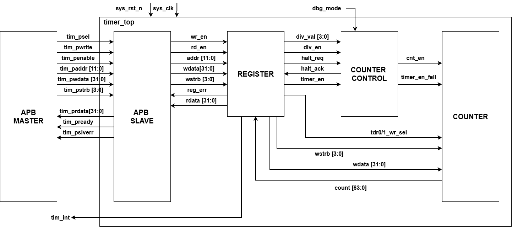
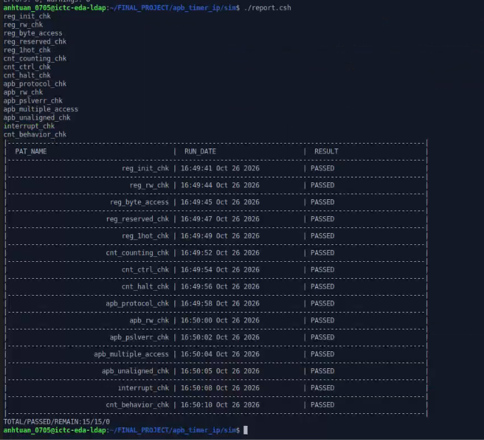
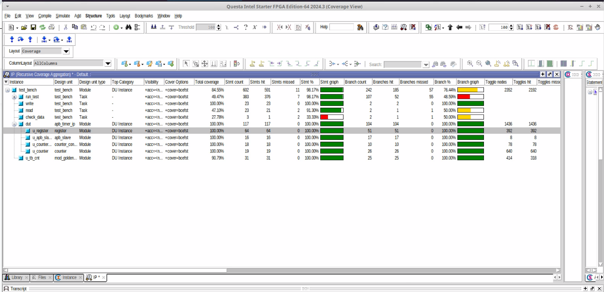
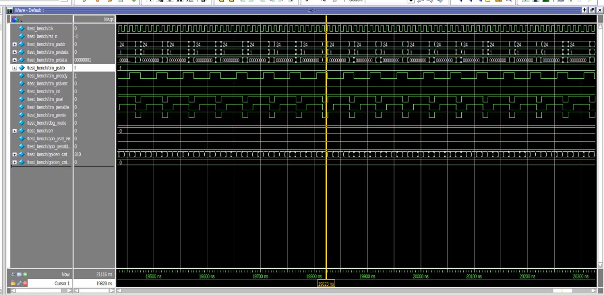

# APB Timer IP Design & Verification

## 1. Overview

This project implements the RTL design and comprehensive verification environment for a 64-bit APB-based Timer IP. The IP is customized based on the Core-Local Interruptor (CLINT) module from industrial RISC-V architectures.

The verification environment tests APB protocol compliance, register access rules, 64-bit prescaled counter operations, hardware auto-clear behavior, debug halted mode, error responses (`tim_pslverr`), and level-triggered interrupt lifecycle management with Write-1-to-Clear (RW1C) status handling.

The project achieves **100% DUT code coverage** across all 14 directed test scenarios in regression.

## 2. DUT Specifications

| Parameter / Feature | Description |
| :--- | :--- |
| **Bus Interface** | APB Slave with 12-bit address bus (`tim_paddr[11:0]`) and 32-bit data bus |
| **Data Transfer** | 32-bit APB transfers with 4-bit byte-enable write strobes (`tim_pstrb[3:0]`) |
| **Wait States** | 1-cycle wait state insertion via `tim_pready` for timing closure |
| **Error Handling** | Error response (`tim_pslverr`) on illegal configuration attempts |
| **Reserved Area** | RAZ/WI (Read-As-Zero, Write-Ignored) compliance on reserved offsets |
| **Counter Architecture** | 64-bit count-up timer (`TDR0` lower 32 bits, `TDR1` upper 32 bits) |
| **Prescaler Modes** | Default mode (system clock speed) and Control mode (divided up to 256) |
| **Auto-Clear** | Hardware automatically clears `TDR0`/`TDR1` to `0` when `timer_en` drops ($H \rightarrow L$) |
| **Debug Mode** | Freezes counting when `dbg_mode = 1` and `THCSR.halt_req = 1`, acknowledging via `THCSR.halt_ack = 1` |
| **Interrupt System** | Hardware maskable level-interrupt (`tim_int`) triggered on 64-bit `TCMP0`/`TCMP1` match with RW1C clearance |
| **Reset** | Active-low asynchronous reset (`sys_rst_n`) |

## 3. Design Architecture



The Timer IP top-level module (`timer_top` / `apb_timer_ip`) consists of four functional blocks:

- **APB Slave:** Translates system APB bus transactions (`tim_psel`, `tim_pwrite`, `tim_penable`, `tim_paddr`, `tim_pwdata`, `tim_pstrb`) into internal read/write strobes (`wr_en`, `rd_en`), generates 1-cycle wait states via `tim_pready`, and asserts `tim_pslverr` upon invalid access.
- **Register:** Decodes 12-bit addresses, stores static configuration registers (`TCR`, `TIER`, `TISR`, `THCSR`), implements RAZ/WI for reserved spaces, manages RW1C clearing logic, and checks for illegal configuration parameters to trigger `reg_err`.
- **Counter Control:** Manages the internal 8-bit prescaler counter (`int_cnt`) based on `div_val` and `div_en`, generates synchronized count enable pulses (`cnt_en`), detects falling edges of `timer_en` (`timer_en_fall`), and controls debug halt request/acknowledge handshaking.
- **Counter:** Houses the physical 64-bit hardware counter (`TDR0` and `TDR1`), handles priority-based loading (Hardware Auto-Clear > APB Byte Writes > Count Increment), and continuously evaluates compare threshold registers (`TCMP0`/`TCMP1`) to drive interrupt request signals.

## 4. Verification Architecture & Scenarios

The verification environment is built around a task-driven testbench (`test_bench.v`) executing modular testcases from the `testcases/` directory.

- **APB Master Driver Tasks:** `test_bench.write()` and `test_bench.read()` generate APB bus transactions with 1-cycle wait state handshaking and byte-strobe positioning.
- **Golden Reference Model:** An internal reference model (`mod_golden_cnt`) tracks expected counter values, interrupt states, and configuration flags in parallel with the DUT.
- **Self-Checking Checkers:** Automated check logic verifies register data integrity, status flags, counter progression, and error signaling against expected values.
- **Testcase Suite:** 14 independent test files (`*.v`) loaded sequentially by the C-shell regression harness (`run.csh` / `report.csh`).

| Test Scenario | Testcase File (`Pat name`) | Verification Objective |
| :--- | :--- | :--- |
| **Register Reset Values** | `reg_init_chk.v` | Verify reset default values across all registers (`TCR`, `TDR0/1`, `TCMP0/1`, `TIER`, `TISR`, `THCSR`). |
| **Register Read / Write** | `reg_rw_chk.v` | Exercise read and write operations on all RW fields and verify read-only bit preservation. |
| **Byte Access** | `reg_byte_access.v` | Verify individual byte writes using `tim_pstrb[3:0]` strobes without corrupting adjacent bytes. |
| **Reserved Space** | `reg_reserved_chk.v` | Verify RAZ/WI behavior when reading or writing to unmapped register addresses. |
| **One-Hot Pattern** | `reg_1hot_chk.v` | Write one-hot patterns across register fields to detect bit-coupling and crosstalk bugs. |
| **Counter Basic Operation** | `cnt_counting_chk.v` | Verify 64-bit counter continuous incrementing in default mode and overflow recovery. |
| **Prescaler Control** | `cnt_ctrl_chk.v` | Verify prescaler frequency division settings (`div_val = 0..8`, divide factor up to 256). |
| **Debug Halted Mode** | `cnt_halt_chk.v` | Assert `dbg_mode` and `THCSR.halt_req`, verifying counter freezing and `halt_ack` assertion. |
| **APB Protocol Timing** | `apb_protocol_chk.v` | Check APB setup phase, access phase timing, and 1-cycle wait state (`tim_pready`). |
| **APB Back-to-Back R/W** | `apb_rw_chk.v` | Stress consecutive APB write and read transfers without idle cycles. |
| **Error Response Handling** | `apb_pslverr_chk.v` | Verify `tim_pslverr` assertion when writing illegal `div_val` or modifying config while active. |
| **Multiple Bus Access** | `apb_multiple_access.v` | Execute multi-word burst transfers to verify bus throughput and stability. |
| **Unaligned Address Access** | `apb_unaligned_chk.v` | Issue unaligned address requests and verify aligned register values remain preserved. |
| **Interrupt Lifecycle** | `interrupt_chk.v` | Verify `tim_int` assertion on match, `TIER` masking, RW1C clearance priority, and auto-clear. |

## 5. Register Specification

| Address | Abbreviation | Register Name | Type | Reset Value | Description |
| :---: | :---: | :---: | :---: | :---: | :--- |
| `0x00` | **TCR** | Timer Control Register | R/W | `0x0000_0100` | Timer enable (`bit 0`), prescaler enable (`bit 1`), and division factor `DIV_VAL` (`bits 11:8`). |
| `0x04` | **TDR0** | Timer Data Register 0 | R/W | `0x0000_0000` | Lower 32-bit counter value. Auto-clears to `0` on `timer_en` $H \rightarrow L$. |
| `0x08` | **TDR1** | Timer Data Register 1 | R/W | `0x0000_0000` | Upper 32-bit counter value. Auto-clears to `0` on `timer_en` $H \rightarrow L$. |
| `0x0C` | **TCMP0** | Timer Compare Register 0 | R/W | `0xFFFF_FFFF` | Lower 32-bit threshold value for interrupt trigger. |
| `0x10` | **TCMP1** | Timer Compare Register 1 | R/W | `0xFFFF_FFFF` | Upper 32-bit threshold value for interrupt trigger. |
| `0x14` | **TIER** | Timer Interrupt Enable Register | R/W | `0x0000_0000` | Interrupt enable mask (`bit 0`). |
| `0x18` | **TISR** | Timer Interrupt Status Register | RW1C | `0x0000_0000` | Interrupt pending status (`bit 0`). Write 1 to clear (`RW1C`). |
| `0x1C` | **THCSR** | Timer Halt Control Status Register | R/W | `0x0000_0000` | Debug halt request (`bit 0`, RW) and halt acknowledge (`bit 1`, RO). |

## 6. Code Coverage

Code coverage was collected using **QuestaSim / ModelSim 2024.3** in coverage mode (`+cover=bcefst`).

- **Statement Coverage:** 100.00% on DUT modules (`apb_slave`, `register`, `counter_control`, `counter`).
- **Branch Coverage:** 100.00% on all `if-else` and `case` decision trees.
- **Toggle Coverage:** 100.00% on all internal register nodes and port signals.
- **Condition / Expression Coverage:** 100.00% across all combinatorial logic expressions.
- **Exclusion File:** `sim/exclude.do` is utilized to exclude unreachable conditions (such as unused testbench helper branches), securing clean 100% DUT code coverage.

## 7. Regression Results

The full regression suite was executed via C-shell automation scripts (`./report.csh`).

| Metric | Result |
| :--- | :--- |
| **Total Testcases Run** | 14 |
| **Passed Testcases** | 14 |
| **Failed Testcases** | 0 |
| **DUT Statement Coverage** | 100.00% |
| **DUT Branch Coverage** | 100.00% |
| **DUT Toggle Coverage** | 100.00% |
| **DUT Condition Coverage** | 100.00% |
| **Regression Status** | **PASSED (14/14/0)** |

### Simulation Evidence

**Regression Testsuite Results (`./report.csh`)**



**QuestaSim Code Coverage Report (100% DUT Coverage)**



**Simulation Waveform (Regression Run)**



## 8. Tools and Technologies

- **Hardware Description Language:** Verilog / SystemVerilog
- **Simulation & EDA Tool:** QuestaSim / ModelSim 2024.3 (Intel Starter FPGA Edition)
- **Scripting & Automation:** C-Shell (`run.csh`, `report.csh`), Make (`Makefile`), Tcl / DO scripts (`exclude.do`)
- **Version Control:** Git & GitHub

## 9. Repository Structure

```text
apb_timer_ip/
├── docs/
│   ├── Timer_Design_Spec.pdf          # Full IP Design Specification PDF
│   ├── VPLAN_TIMER_IP.xlsx            # Verification Plan Excel Spreadsheet
│   ├── block_diagram.png              # IP Architecture Block Diagram
│   ├── regression_result.png          # Regression test output log screenshot
│   ├── code_coverage_result.png       # QuestaSim 100% coverage GUI screenshot
│   └── waveform_regression_test.png   # Simulation waveform screenshot
├── rtl/
│   ├── apb_slave.v                    # APB protocol decoder & wait state logic
│   ├── register.v                     # Address decoder & register array
│   ├── counter_control.v              # Prescaler generator & debug halt logic
│   ├── counter.v                      # 64-bit counter & interrupt comparator
│   └── apb_timer_ip.v                 # Top-level IP wrapper
├── sim/
│   ├── compile.f                      # Simulation compile file list
│   ├── exclude.do                     # Coverage exclusion rules
│   ├── Makefile                       # Build automation script
│   ├── pat.list                       # Pattern list for regression
│   ├── report.csh                     # Automated regression reporter script
│   ├── rtl.f                          # RTL file list
│   ├── run.csh                        # Test execution script
│   └── tb.f                           # Testbench file list
├── tb/
│   └── test_bench.v                   # SystemVerilog top-level testbench
├── testcases/                         # 14 modular testcase files
│   ├── apb_multiple_access.v
│   ├── apb_protocol_chk.v
│   ├── apb_pslverr_chk.v
│   ├── apb_rw_chk.v
│   ├── apb_unaligned_chk.v
│   ├── cnt_counting_chk.v
│   ├── cnt_ctrl_chk.v
│   ├── cnt_halt_chk.v
│   ├── interrupt_chk.v
│   ├── reg_1hot_chk.v
│   ├── reg_byte_access.v
│   ├── reg_init_chk.v
│   ├── reg_reserved_chk.v
│   └── reg_rw_chk.v
├── .gitignore                         # Simulation temporary files exclusion rules
└── README.md                          # Project overview and documentation
```
## 10. Key Learning Outcomes

Through this project, I demonstrated and refined essential skills in industry-standard RTL design and verification methodologies:

- **AMBA APB Protocol Integration:** Designed a compliant APB slave interface supporting 32-bit transfers, 4-bit byte strobes (`tim_pstrb`), 1-cycle wait-state insertion (`tim_pready`), and error signaling (`tim_pslverr`) for illegal accesses.
- **Microarchitecture & RTL Implementation:** Developed a 64-bit multi-mode counter with flexible prescaling (up to divide-by-256), hardware auto-clear on enable fall, and debug halt mode handshaking (`halt_req`/`halt_ack`).
- **Hardware Interrupt Management:** Built a maskable level-interrupt generation block triggered by 64-bit compare logic (`TCMP0`/`TCMP1`) featuring Write-1-to-Clear (`RW1C`) status handling.
- **Verification Planning & Testbench Development:** Created a comprehensive Verification Plan (VPlan in Excel), mapping spec requirements to test cases, and constructed a task-driven self-checking testbench with golden reference model comparison.
- **Code Coverage & Exclusion Analysis:** Conducted full code coverage analysis (Statement, Branch, Condition, Toggle) using QuestaSim, writing custom exclusion scripts (`exclude.do`) to eliminate unreachable logic and achieve **100% DUT Code Coverage**.
- **Regression & EDA Automation:** Implemented C-Shell automation scripts (`run.csh`, `report.csh`) and Makefiles to automate simulation execution, log parsing, and regression summary reporting.

## 11. Documentation & References

- [Timer IP Design Specification (PDF)](docs/Timer_Design_Spec.pdf) — Comprehensive architectural spec, register map, and timing diagrams.
- [Timer IP Verification Plan (Excel)](docs/VPLAN_TIMER_IP.xlsx) — Verification scope, test scenario matrix, and feature coverage mapping.