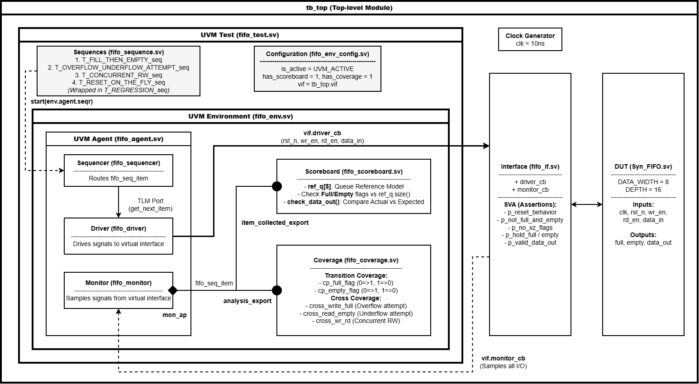
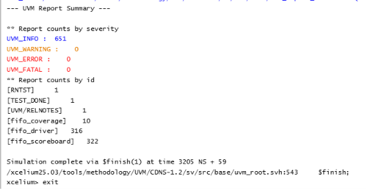
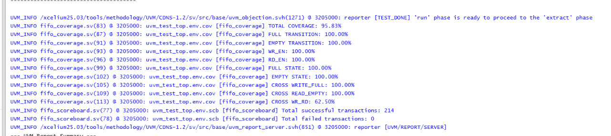
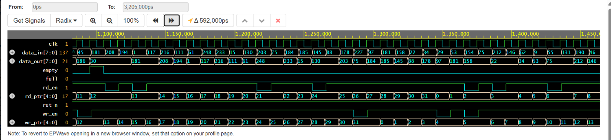
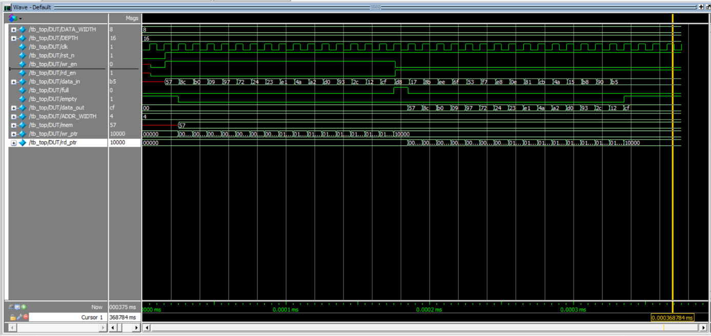

# Synchronous FIFO Design Verification using SystemVerilog UVM

## 1. Overview

This project implements a SystemVerilog UVM-based verification environment for a synchronous FIFO (First-In, First-Out) design.

The testbench verifies FIFO behavior under normal operating conditions, boundary conditions, concurrent read/write operations, and reset scenarios. A reference queue serves as the expected data model, while the scoreboard checks the DUT behavior against expected results.

The project focuses on reusable UVM components, self-checking verification, functional coverage, and regression testing.

## 2. DUT Specifications

| Parameter | Description |
| :--- | :--- |
| **Data Width** | 8 bits |
| **FIFO Depth** | 16 entries |
| **Clock** | Single synchronous clock (`clk`) |
| **Reset** | Active-low reset (`rst_n`) |
| **Inputs** | `clk`, `rst_n`, `wr_en`, `rd_en`, `data_in` |
| **Outputs** | `full`, `empty`, `data_out` |

## 3. Verification Architecture



The verification environment follows a modular UVM architecture:

- **UVM Test:** Configures the verification environment and starts the selected sequences (`fifo_test.sv`).
- **Sequences:** Generate stimulus for normal operations, overflow/underflow attempts, concurrent read/write operations, and reset scenarios (`fifo_sequence.sv`).
- **Sequencer:** Manages sequence items and passes them to the driver.
- **Driver:** Converts sequence items into pin-level stimulus through the virtual interface.
- **Monitor:** Samples DUT interface activity through `monitor_cb` and publishes observed transactions through an analysis port.
- **Scoreboard:** Maintains a reference queue (`ref_q[$]`), checks FIFO status flags (`full`, `empty`), and compares actual output data against expected data.
- **Functional Coverage:** Tracks FIFO state transitions and selected read/write scenarios using a UVM subscriber.
- **Interface:** Provides clocking blocks for coordinated signal driving and sampling, together with the SystemVerilog Assertions (SVA) implemented in the testbench.
- **DUT:** The synchronous FIFO RTL being verified.

The environment uses an active agent, scoreboard, and coverage collector configured through the verification environment configuration.

## 4. Verification Scenarios

| Test Scenario | Sequence Name | Verification Objective |
| :--- | :--- | :--- |
| **Fill Then Empty** | `T_FILL_THEN_EMPTY_seq` | Fill the FIFO to its capacity of 16 entries, then read the stored data and check data ordering. |
| **Overflow and Underflow Attempts** | `T_OVERFLOW_UNDERFLOW_ATTEMPT_seq` | Attempt a write while the FIFO is full and a read while it is empty, then check the expected behavior. |
| **Concurrent Read/Write** | `T_CONCURRENT_RW_seq` | Exercise simultaneous read and write requests under different FIFO operating conditions. |
| **Reset During Operation** | `T_RESET_ON_THE_FLY_seq` | Apply reset during FIFO activity and check the resulting behavior and recovery. |
| **Regression** | `T_REGRESSION_seq` | Run multiple verification scenarios through a regression sequence. |

## 5. Scoreboard and Reference Model

The scoreboard (`fifo_scoreboard.sv`) uses a SystemVerilog queue (`ref_q[$]`) as a reference model for the expected FIFO contents.

Its main responsibilities include:

- Updating the reference model according to accepted write (`wr_en = 1`, `full = 0`) and read (`rd_en = 1`, `empty = 0`) operations.
- Checking the `full` and `empty` flags against the reference queue state (`ref_q.size()`).
- Comparing actual output data with the expected data from the reference model.
- Reporting mismatches to help identify functional bugs.

The reference model is maintained independently of the DUT's internal storage implementation.

## 6. Functional Coverage

The functional coverage model (`fifo_coverage.sv`) tracks the following behaviors:

- **Full Transition Coverage:** Transitions from not-full to full (`0 → 1`) and full to not-full (`1 → 0`).
- **Empty Transition Coverage:** Transitions from not-empty to empty (`0 → 1`) and empty to not-empty (`1 → 0`).
- **Write/Read Enable Coverage:** Exercises both values of the write and read enable signals.
- **Overflow Attempt Coverage:** Covers write requests while the FIFO is full (`cross_write_full`).
- **Underflow Attempt Coverage:** Covers read requests while the FIFO is empty (`cross_read_empty`).
- **Concurrent Read/Write Coverage:** Tracks combinations of write enable, read enable, and FIFO status (`cross_wr_rd`), including simultaneous read and write requests while the FIFO is neither full nor empty.

The current regression achieved **95.83% total functional coverage**. The `cross_wr_rd` coverage reached **62.50%**, indicating that additional concurrent read/write combinations remain to be exercised.

Coverage results are based on the configured coverage model. Coverage percentages measure the coverage bins hit during simulation and do not, by themselves, prove exhaustive verification of all possible FIFO behaviors.

## 7. Regression Results

The regression was executed using **Cadence Xcelium v25.03** with UVM 1.2.

| Metric | Result |
| :--- | :--- |
| **Regression Status** | Completed with no reported UVM errors |
| **Transactions Checked** | 214 successful |
| **Failed Transactions** | 0 |
| **Total Functional Coverage** | 95.83% |
| **Full Transition Coverage** | 100.00% |
| **Empty Transition Coverage** | 100.00% |
| **Write Enable Coverage** | 100.00% |
| **Read Enable Coverage** | 100.00% |
| **Full State Coverage** | 100.00% |
| **Empty State Coverage** | 100.00% |
| **Overflow Cross Coverage** | 100.00% |
| **Underflow Cross Coverage** | 100.00% |
| **Concurrent Read/Write Cross Coverage** | 62.50% |
| **UVM Warnings / Errors / Fatals** | 0 / 0 / 0 |

### Simulation Evidence

**UVM Regression Summary**



**Functional Coverage Report**



**Regression Waveform**



**Full/Empty Transition Waveform**



## 8. Tools and Technologies

- SystemVerilog
- Universal Verification Methodology (UVM 1.2)
- Cadence Xcelium v25.03
- EDA Playground
- Git and GitHub

## 9. Repository Structure

```text
sync-fifo-uvm-verification/
├── docs/
│   ├── uvm_sync_fifo_architecture.png
│   ├── coverage_report.png
│   ├── regression_summary.png
│   ├── regression_waveform.png
│   └── full_empty_waveform.png
├── rtl/
│   └── design.sv
├── tb/
│   ├── fifo_agent.sv
│   ├── fifo_coverage.sv
│   ├── fifo_driver.sv
│   ├── fifo_env_config.sv
│   ├── fifo_env.sv
│   ├── fifo_if.sv
│   ├── fifo_monitor.sv
│   ├── fifo_pkg.sv
│   ├── fifo_scoreboard.sv
│   ├── fifo_seq_item.sv
│   ├── fifo_sequence.sv
│   ├── fifo_sequencer.sv
│   ├── fifo_test.sv
│   └── testbench.sv
├── .gitignore
└── README.md
```

## 10. Key Learning Outcomes

Through this project, I practiced:

- Building a modular UVM testbench.
- Developing sequences, sequence items, drivers, and monitors.
- Using a reference queue for self-checking verification.
- Implementing scoreboard checks for data integrity and FIFO status flags.
- Developing functional coverage for state transitions and read/write cross scenarios.
- Integrating SystemVerilog Assertions (SVA) into the verification environment.
- Running regression tests and analyzing simulation logs, coverage reports, and waveforms.

## 11. Future Improvements

- Improve concurrent read/write coverage by targeting the remaining uncovered bins.
- Add more corner-case scenarios based on the FIFO specification.
- Extend assertion-based verification for reset behavior, control signals, and FIFO boundary conditions.
- Improve constrained-random stimulus and transaction timing variation.
- Enhance regression reporting with per-test summaries and automated coverage analysis.
